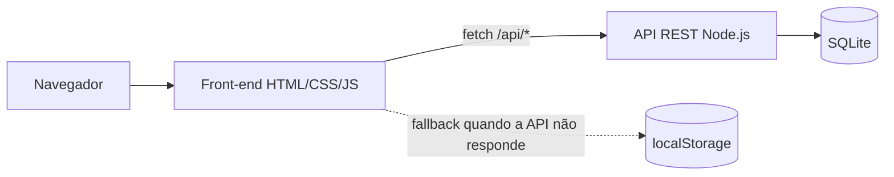

# Estudo de caso — CRUD de Clientes

**Stack:** Node.js · SQLite · JavaScript · HTML/CSS · Docker · GitHub Actions  
**Demo:** https://gilvamoliveira.github.io/CRUD/  
**Código:** https://github.com/GilvamOliveira/CRUD

## Contexto

O projeto começou como um exercício de cadastro de clientes em HTML, CSS e JavaScript, com um layout base de aula. Aos poucos, o formulário deixou de ser suficiente: era preciso buscar, filtrar, paginar, evitar duplicidade e não perder dados quando a exclusão fosse um engano.

Em vez de refazer a interface, evoluí o exercício para uma aplicação full stack. O front-end continua estático, mas agora conversa com uma API REST e um banco SQLite. Quando a API não está disponível, como no GitHub Pages, a aplicação usa `localStorage` e mantém o CRUD funcional.

## Problema

Um cadastro simples não sustenta uso real. Sem paginação, a lista cresce e fica lenta. Sem validação no servidor, regras importantes ficam apenas no navegador. Sem soft delete, uma exclusão acidental é definitiva. E uma demonstração online não deveria depender de um back-end ligado.

## Objetivo

- Entregar CRUD completo de clientes com uma única interface.
- Funcionar em dois modos: API REST + SQLite ou fallback local.
- Manter comportamento, validação e feedback consistentes nos dois modos.
- Automatizar testes e o processo de build/publicação.

## Escopo entregue

- Cadastro, edição, exclusão e restauração de clientes.
- Busca, filtros por estado/cidade, ordenação e paginação no servidor.
- Dashboard com total de clientes, estados atendidos e distribuição por estado.
- Importação JSON com prévia, validação e bloqueio de duplicados.
- Exportação CSV e backup JSON.
- Exclusão em lote com seleção por checkbox e desfazer via soft delete.
- Autenticação opcional por token Bearer, ativada por variável de ambiente.
- Validação por campo, máscara de celular, toasts, modais e foco acessível.
- Layout responsivo, com atenção a `aria-*` e navegação por teclado.

## Arquitetura

A API usa apenas módulos nativos do Node.js: `node:http` para o servidor, `node:sqlite` para o banco e `node:crypto` para tokens. Não há dependências de produção. O front-end detecta se a API está disponível e escolhe o adaptador de dados; o restante da interface não precisa saber de onde os dados vêm.

## Decisões técnicas

1. **Node.js sem framework.** O escopo não exigia Express ou ORM. Usar os módulos nativos reduziu dependências e tornou o custo de execução e deploy mais previsível.
2. **Soft delete em vez de `DELETE` físico.** O registro recebe `excluido_em` e some das listagens, mas continua no banco. Isso viabiliza o botão “Desfazer” sem uma tabela de auditoria separada.
3. **Validação compartilhada entre cliente e servidor.** O front-end dá feedback imediato; a API reaplica as regras e responde `422` com os campos inválidos. A regra nunca depende só do navegador.
4. **Fallback local como modo de demonstração.** O GitHub Pages não executa o servidor. O adaptador em `localStorage` mantém a demo útil e permite testar o fluxo completo sem instalar nada.
5. **Autenticação opcional.** Definir `ADMIN_PASSWORD` ativa a tela de login e o envio de `Authorization: Bearer <token>`. Sem a variável, a API fica aberta para desenvolvimento local — uma escolha explícita, documentada no README.
6. **Paginação no servidor.** A API recebe `page`, `limit`, `busca`, `estado`, `cidade`, `ordem` e `direcao`, e devolve `items`, `total`, `page`, `limit` e `totalPages`.

## Testes e qualidade

- `node:test` cobre API, autenticação e validações: **23 testes**, todos passando.
- ESLint e Prettier para consistência de código.
- GitHub Actions executa os testes a cada push.
- `Dockerfile` e `render.yaml` documentam o caminho de publicação do back-end.

## Desafios

- **Manter dois modos de dados equivalentes.** A solução foi isolar o acesso em `storage.js` e `api.js`, com a mesma interface para o restante da aplicação.
- **Duplicidade de e-mail e celular.** A checagem acontece no front-end para feedback rápido e no banco com restrições `UNIQUE` para garantir a regra.
- **Exclusão em lote com desfazer.** O soft delete simplificou o fluxo, mas exigiu ajustar todas as consultas para ignorar registros excluídos.
- **Segurança da saída.** A renderização evita inserir dados do usuário como HTML, reduzindo risco de XSS.

## Limites e próximos passos

- Perfis de usuário e permissões (admin/consulta).
- Histórico de alterações para auditoria.
- Suporte a PostgreSQL para volumes maiores.
- Testes de integração no navegador para os fluxos de importação e desfazer.

## Créditos

Layout base do Prof. Fernando Leonid. Back-end, novas funcionalidades, correções, testes e documentação desenvolvidos por mim.
