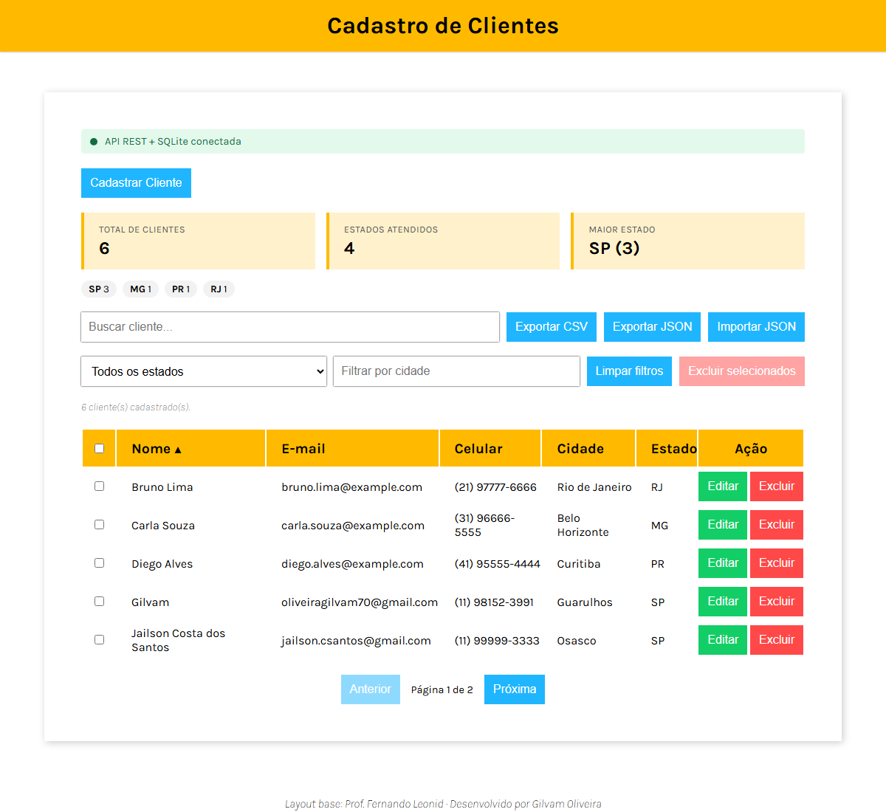

# Cadastro de Clientes (CRUD)

Aplicação web para **cadastrar, listar, editar e excluir clientes**, feita com HTML, CSS e JavaScript puro. Possui **API REST com banco de dados SQLite** e funciona também de forma estática, usando `localStorage` como fallback quando o servidor não está disponível.

🔗 **Demo online:** https://gilvamoliveira.github.io/CRUD/



## Funcionalidades

- **Cadastrar, editar e excluir** clientes (nome, e-mail, celular, cidade e estado), com confirmação antes de excluir
- **API REST** com rotas `GET`, `POST`, `PUT` e `DELETE` para os clientes
- **Banco de dados SQLite** no servidor, com validação e bloqueio de duplicados também no back-end
- **Busca** em tempo real por nome, e-mail, celular, cidade ou estado, com contador de resultados
- **Paginação** da tabela, com botões Anterior/Próxima e indicação da página atual
- **Ordenação** da tabela ao clicar no cabeçalho de cada coluna, com indicador visual de ordem crescente/decrescente
- **Máscara de celular** automática no formato `(11) 99999-8888`
- **Bloqueio de e-mail e celular duplicados**, sem diferenciar maiúsculas de minúsculas no e-mail
- **Exportação em CSV** de todos os clientes, pronta para abrir no Excel
- **Backup em JSON** para exportar e importar os cadastros em outro navegador ou computador
- **Importação segura**: valida o arquivo, ignora registros incompletos e não duplica e-mails
- **Estado vazio** com orientação quando não há clientes ou a busca não retorna resultados
- **Proteção contra XSS**: os dados digitados são tratados antes de serem exibidos na tabela
- **Modal de cadastro** que fecha com o botão Cancelar, com o ✖ ou com a tecla `Esc`, e salva com `Enter`
- **Layout responsivo** para desktop e celular

## Tecnologias

- HTML5
- CSS3
- JavaScript (ES6+), sem frameworks
- Node.js com `node:http` e `node:sqlite` (sem dependências externas)
- API REST com banco de dados SQLite
- `localStorage` como fallback para a versão estática
- GitHub Pages para a publicação da demo online

## Estrutura do projeto

```
CRUD/
├── index.html
├── main.js
├── server/
│   ├── package.json
│   └── server.js
├── css/
│   ├── main.css
│   ├── button.css
│   ├── records.css
│   └── modal.css
├── img/
│   └── tela.png
└── .gitignore
```

## Como rodar

### Versão estática (com `localStorage`)

1. Clone o repositório:
   ```bash
   git clone https://github.com/GilvamOliveira/CRUD.git
   ```
2. Abra a pasta `CRUD` e dê dois cliques no `index.html`.

Não precisa instalar nada.

### Versão com API REST e SQLite

Requer **Node.js 22.5 ou superior** (por causa do módulo nativo `node:sqlite`). Não é necessário rodar `npm install`, pois o projeto não usa dependências externas.

1. Na raiz do projeto, inicie o servidor:
   ```bash
   node server/server.js
   ```
2. Acesse http://localhost:3000 no navegador.

O próprio servidor entrega o front-end e a API. O banco fica em `server/clientes.db`, criado automaticamente na primeira execução.

Rotas da API:

| Método | Rota | Descrição |
| --- | --- | --- |
| `GET` | `/api/clientes` | Lista todos os clientes |
| `GET` | `/api/clientes/:id` | Busca um cliente |
| `POST` | `/api/clientes` | Cadastra um cliente |
| `PUT` | `/api/clientes/:id` | Atualiza um cliente |
| `DELETE` | `/api/clientes/:id` | Exclui um cliente |
| `GET` | `/api/health` | Verifica se a API está no ar |

## Observações

Ao abrir a página, o front-end detecta automaticamente se a API está disponível. Em `localhost:3000` ele usa a API e o SQLite; aberto como arquivo ou no GitHub Pages, cai no `localStorage`.

Na versão estática, os dados pertencem ao navegador e ao computador em que foram cadastrados. Limpar os dados do navegador apaga os clientes. Por isso, use o **Exportar JSON** para manter um backup e o **Importar JSON** para restaurar os cadastros em outro navegador.

O **Exportar CSV** gera um arquivo com todos os clientes (não apenas os filtrados pela busca), usando `;` como separador e codificação UTF-8.

## Próximos passos

- Autenticação de usuários para proteger a API
- Testes automatizados do back-end e do front-end
- Deploy do back-end em um serviço de hospedagem

## Créditos

Projeto desenvolvido durante o curso, a partir do layout base do Prof. Fernando Leonid.

Melhorias e correções feitas por mim: busca, ordenação por coluna, máscara de celular, campo de estado, bloqueio de e-mail duplicado, proteção contra XSS, correção de bugs no fluxo de edição, contador de resultados, estado vazio, exportação CSV, backup/importação JSON, bloqueio de celular duplicado, salvamento com `Enter`, paginação e back-end com API REST e SQLite.

## Autor

**Gilvam Júnior Oliveira**

[LinkedIn](https://linkedin.com/in/gilvam-oliveira) · [GitHub](https://github.com/GilvamOliveira)
