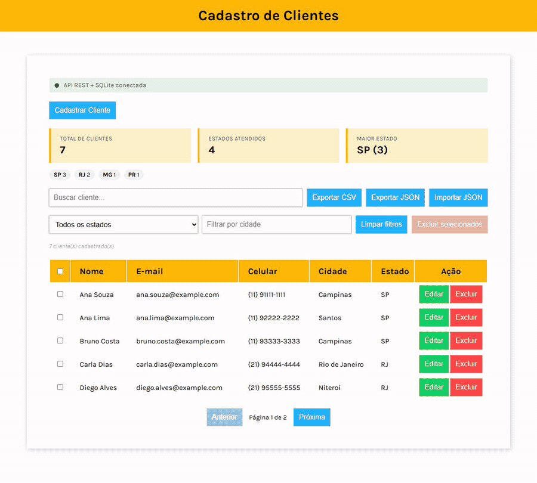

# Cadastro de Clientes (CRUD)

Aplicação web para **cadastrar, listar, editar e excluir clientes**, feita com HTML, CSS e JavaScript puro. Possui **API REST com banco de dados SQLite**, paginação feita no servidor, autenticação opcional e um **fallback para `localStorage`** quando o back-end não está disponível (por exemplo, na demo do GitHub Pages).

**Demo online:** https://gilvamoliveira.github.io/CRUD/

## Demonstração



Cadastro de cliente, busca, filtros, paginação e exclusão em lote com desfazer.

## Funcionalidades

- **Cadastrar, editar e excluir** clientes (nome, e-mail, celular, cidade e estado)
- **API REST** com rotas `GET`, `POST`, `PUT` e `DELETE`
- **Banco SQLite** com `UNIQUE` para e-mail e celular, índices e migrações automáticas
- **Paginação, busca, filtros e ordenação no servidor**, com contador de resultados
- **Filtros por estado e cidade**, com botão para limpar todos os filtros
- **Dashboard** com total de clientes, estados atendidos e distribuição por estado
- **Exclusão em lote** com seleção por checkbox e **desfazer** (soft delete)
- **Importação JSON com prévia**, validação e bloqueio de duplicados
- **Exportação CSV** pronta para o Excel e **backup em JSON**
- **Bloqueio de e-mail e celular duplicados** no front-end e no banco
- **Autenticação opcional por token** (`Bearer`) com tela de login
- **Rate limiting** e cabeçalhos de segurança na API
- **Toasts**, confirmação em modal, estados de carregamento e foco preso no modal
- **Validação por campo**, máscara de celular `(11) 99999-8888` e envio com `Enter`
- **Acessibilidade**: `aria-*`, navegação por teclado e contraste nos avisos
- **Layout responsivo** para desktop e celular

## Tecnologias

- HTML5 e CSS3
- JavaScript (ES6+), sem frameworks
- Node.js com `node:http`, `node:sqlite` e `node:crypto` (sem dependências em produção)
- API REST com banco SQLite
- `localStorage` como fallback para a versão estática
- Testes com `node:test`, ESLint, Prettier e GitHub Actions
- Docker e Render para publicação do back-end

## Estrutura do projeto

```
CRUD/
├── index.html
├── js/
│   ├── validacao.js
│   ├── storage.js
│   ├── api.js
│   ├── ui.js
│   └── app.js
├── server/
│   ├── package.json
│   └── server.js
├── css/
│   ├── main.css
│   ├── button.css
│   ├── records.css
│   └── modal.css
├── tests/
│   ├── api.test.js
│   ├── auth.test.js
│   └── validacao.test.js
├── img/
│   └── demo.gif
├── .github/workflows/ci.yml
├── Dockerfile
└── render.yaml
```

## Como rodar

### Versão estática (com `localStorage`)

1. Clone o repositório:
   ```bash
   git clone https://github.com/GilvamOliveira/CRUD.git
   ```
2. Abra a pasta `CRUD` e dê dois cliques no `index.html`.

Não precisa instalar nada. Todos os recursos de CRUD, filtros, paginação, backup e importação funcionam localmente.

### Versão com API REST e SQLite

Requer **Node.js 22.5 ou superior** (por causa do módulo nativo `node:sqlite`). Não há dependências de produção, então não é necessário rodar `npm install` só para executar.

1. Na raiz do projeto, inicie o servidor:
   ```bash
   npm start
   # ou: node server/server.js
   ```
2. Acesse http://localhost:3000.

O banco é criado automaticamente em `server/clientes.db`. Para usar outro caminho, defina `DB_PATH`.

### Testes e qualidade

```bash
npm install   # instala apenas as ferramentas de desenvolvimento
npm test      # testes da API, autenticação e validações
npm run lint  # ESLint
npm run format
```

## Configuração

| Variável | Padrão | Descrição |
| --- | --- | --- |
| `PORT` | `3000` | Porta do servidor |
| `DB_PATH` | `server/clientes.db` | Caminho do banco SQLite |
| `ADMIN_PASSWORD` | vazio | Ativa a autenticação por token quando definida |
| `ADMIN_SECRET` | aleatório | Segredo usado para assinar os tokens |
| `ALLOWED_ORIGINS` | `http://localhost:3000,http://127.0.0.1:3000` | Origens liberadas no CORS |

## API REST

| Método | Rota | Descrição |
| --- | --- | --- |
| `GET` | `/api/health` | Status do servidor e se a autenticação está ativa |
| `POST` | `/api/login` | Gera um token a partir da senha (`{ "senha": "..." }`) |
| `GET` | `/api/clientes` | Lista clientes com paginação, busca, filtros e ordenação |
| `GET` | `/api/clientes/:id` | Busca um cliente |
| `POST` | `/api/clientes` | Cadastra um cliente |
| `PUT` | `/api/clientes/:id` | Atualiza um cliente |
| `DELETE` | `/api/clientes/:id` | Exclui (soft delete) um cliente |
| `POST` | `/api/clientes/lote/excluir` | Exclui vários clientes (`{ "ids": [1, 2] }`) |
| `POST` | `/api/clientes/lote/restaurar` | Restaura clientes excluídos |
| `GET` | `/api/estatisticas` | Total e quantidade por estado |

Parâmetros da listagem: `page`, `limit` (máximo 100), `busca`, `estado`, `cidade`, `ordem` e `direcao` (`asc`/`desc`). A resposta tem o formato:

```json
{
  "items": [],
  "total": 0,
  "page": 1,
  "limit": 5,
  "totalPages": 1
}
```

Erros de validação retornam `422` com o campo `fields`, permitindo destacar cada input no front-end.

## Autenticação

Defina `ADMIN_PASSWORD` para proteger a API:

```bash
ADMIN_PASSWORD=minha-senha ADMIN_SECRET=um-segredo npm start
```

Sem essa variável, a API fica aberta (útil no desenvolvimento local). Com ela, o front-end exibe a tela de login e envia o token no cabeçalho `Authorization: Bearer <token>`.

## Publicação

- **Front-end estático:** o GitHub Pages continua funcionando com o fallback em `localStorage`.
- **Back-end:** o projeto inclui `Dockerfile` e `render.yaml` (Render com disco persistente em `/data`). Configure `ADMIN_PASSWORD` e `ADMIN_SECRET` no painel do serviço.

Para testar a imagem Docker localmente:

```bash
docker build -t crud-clientes .
docker run -p 3000:3000 -e ADMIN_PASSWORD=senha -v crud-data:/data crud-clientes
```

## Observações

Ao abrir a página, o front-end detecta automaticamente se a API está disponível. Em `localhost:3000` ele usa a API e o SQLite; aberto como arquivo ou no GitHub Pages, usa o `localStorage`.

A exclusão é **lógica** (`excluido_em`): o registro sai das listagens, mas permanece no banco para permitir o botão **Desfazer**. O mesmo vale para a versão local.

O **Exportar CSV** gera um arquivo com todos os clientes ativos, usando `;` como separador e codificação UTF-8.

## Próximos passos

- Perfis de usuário e permissões (admin/consulta)
- Histórico de alterações (auditoria)
- Suporte a PostgreSQL para grandes volumes
- Envio de e-mail de confirmação no cadastro

## Créditos

Projeto desenvolvido durante o curso, a partir do layout base do Prof. Fernando Leonid.

Melhorias e correções feitas por mim: busca, ordenação por coluna, máscara de celular, campo de estado, bloqueio de e-mail duplicado, proteção contra XSS, correção de bugs no fluxo de edição, contador de resultados, estado vazio, exportação CSV, backup/importação JSON, bloqueio de celular duplicado, salvamento com `Enter`, paginação, back-end com API REST e SQLite, autenticação, filtros, dashboard, exclusão em lote com desfazer e testes automatizados.

## Autor

**Gilvam Júnior Oliveira**

[LinkedIn](https://linkedin.com/in/gilvam-oliveira) · [GitHub](https://github.com/GilvamOliveira)
